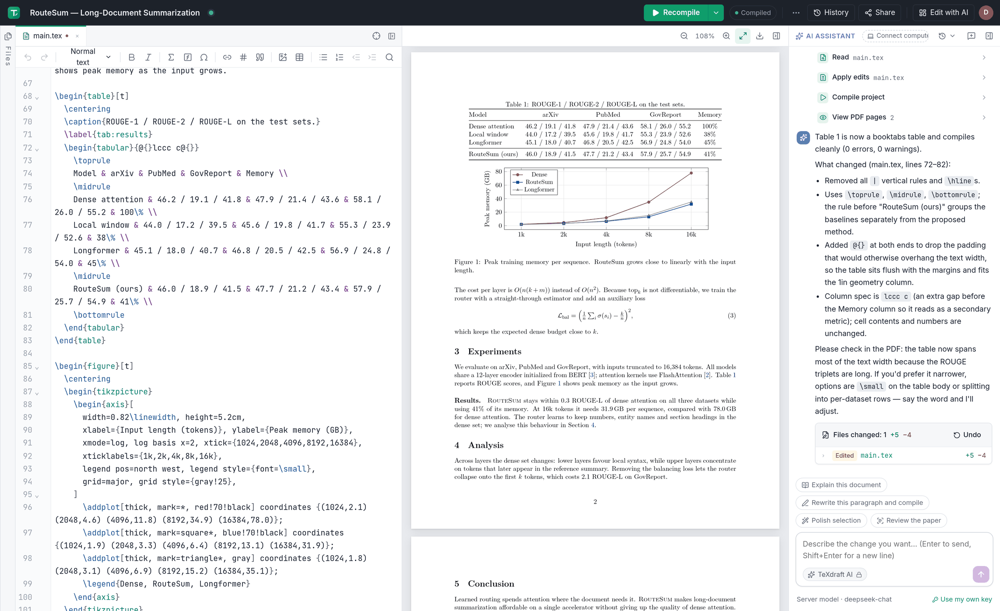

<h1 align="center">TeXdraft</h1>

<p align="center"><b>The paper workspace for the agent era.</b></p>

<p align="center">
A collaborative LaTeX editor where AI agents work on your paper the way a co-author would.<br>
They read the whole project, make the edits, compile, read the errors and fix them, while you watch.
</p>

<p align="center">
<a href="LICENSE"></a>


</p>

<p align="center">
<a href="https://texdraft.app"><b>✨ Try it online</b></a> ·
<a href="README.zh-CN.md">简体中文</a> ·
<a href="#get-started">Get started</a> ·
<a href="docs/connect-agents.md">Connect your agent</a> ·
<a href="docs/self-hosting.md">Self-hosting</a>
</p>

<p align="center"></p>
<p align="center"><sub>Asked to turn Table 1 into a booktabs table, the agent edits the source, compiles, looks at the PDF and reports back, with one-click undo.</sub></p>

---

Most AI writing tools are a chat box next to your document: you copy text in and paste answers back. Coding agents work differently. They open the files, make the change, run the build and fix what broke. **TeXdraft gives your paper the same kind of agent.**

Ask for something like:

> *"Fix the compile errors."* · *"Turn Table 2 into booktabs and make it fit the column."* · *"Find the original Transformer paper and cite it in the related work."* · *"Rename `fig:arch` to `fig:overview` everywhere."* · *"Check whether Figure 3 lands on the right page."*

The agent reads the relevant files, edits them, compiles the paper and looks at the result, rendered PDF pages included. Then it tells you what it changed. Your co-authors see every edit appear live in their editors. If you don't like the result, **one click undoes the whole run**.

## Why TeXdraft

**🤖 Bring the agent you already use.**
Drive the **Claude Code** or **Codex** on your own computer straight from TeXdraft's chat, on your existing subscription. You can also connect **ChatGPT**, **Claude.ai**, **Gemini CLI** or any other MCP client. If you'd rather not, use the built-in agent with Claude, DeepSeek, OpenAI, Gemini, Qwen, Kimi, GLM, OpenRouter or a local Ollama model, with your own key.

**👥 Built for co-authors, not just for you.**
Real-time collaboration with live cursors and owner / editor / viewer roles. AI edits are applied as minimal changes inside the shared document, so they never overwrite what a co-author is typing at the same moment.

**🛡️ Safe to let it work.**
- Every AI run is checkpointed and can be undone.
- Agents can reach only the projects you grant, and connected local agents cannot touch the files on your computer.
- An edit log records who changed which lines and when, and whether the change came from a person or an agent.
- Compiles run in a sandbox, isolated from the server.

**🔓 Open and yours.**
Open source under the AGPL and self-hosted with one Docker command. Your papers stay on your server, and you are never locked into one model vendor.

## Everything you expect from a LaTeX editor

- **Writing**
  - Syntax highlighting, real-time linting, smart completion for commands, environments, `\cite`, `\ref` and `\includegraphics`
  - Outline, project-wide search and replace, symbol palette, figure and table helpers, word count
- **Compiling**
  - Fast incremental compiles with pdfLaTeX, XeLaTeX or LuaLaTeX
  - Full Chinese / CJK support
  - Errors you can click to jump to the source
  - PDF preview with two-way SyncTeX
- **References**: search Crossref and arXiv, and verified BibTeX is written into your `.bib`. The agent is told never to invent a citation.
- **Selection AI**: select text to polish, translate, shorten, expand, fix grammar or explain it, or give your own instruction.
- **History**: version history with per-file diffs and restore, plus automatic snapshots.
- **Import and export**: drag a zip exported from Overleaf or GitHub into the upload dialog, and export any project as a zip.
- **Organising**
  - Tag projects to sort your project list; tags are personal, so you can file shared projects your own way
  - Folders in a project, including empty ones, that you can rename, move or delete with their contents
- **Administration**
  - Open, invite-only or closed registration
  - Per-user AI keys stored encrypted
  - Admin-controlled daily allowances on the server's key

## Get started

**Try it online**: open **[texdraft.app](https://texdraft.app)** and sign up. There is nothing to install. The public demo has usage limits, so for real work, self-host it.

**Self-host with Docker** (TeX Live with Chinese support included):

```bash
git clone https://github.com/songboyangy/texdraft.git && cd texdraft
cp deploy/.env.example deploy/.env   # set POSTGRES_PASSWORD, SESSION_SECRET, PUBLIC_URL and an AI key
docker compose -f deploy/docker-compose.yml up -d --build
```

Open http://127.0.0.1:8787 and sign up. The first account becomes the administrator.

Next steps:

- [Connect Claude Code, Codex, ChatGPT or Claude.ai](docs/connect-agents.md)
- [Self-hosting guide](docs/self-hosting.md): running without Docker, configuration, the security model
- [Deployment details](deploy/README.md): HTTPS, backups, upgrades

## Roadmap

TeXdraft is young and moving fast. Next up:

- Suggestion mode (track changes)
- Comments

Ideas and bug reports are welcome in [Issues](https://github.com/songboyangy/texdraft/issues).

## Contributing

Contributions are welcome. Start with [CONTRIBUTING.md](CONTRIBUTING.md) and the [development guide](docs/development.md). Before your first pull request is merged, you'll be asked to sign a short [Contributor License Agreement](CLA.md). Please report security issues privately; see [SECURITY.md](SECURITY.md).

## License

TeXdraft is licensed under the [GNU AGPL-3.0](LICENSE). If you run a modified version as a network service, you must offer its source code to its users. Contributions are accepted under the [CLA](CLA.md), so that TeXdraft can also be offered under other terms, and every version that contains a contribution stays open source.

TeXdraft's LaTeX language support and completion data come from [Overleaf](https://github.com/overleaf/overleaf) (AGPL-3.0). Thank you to the Overleaf team. See [NOTICE](NOTICE) for details.
