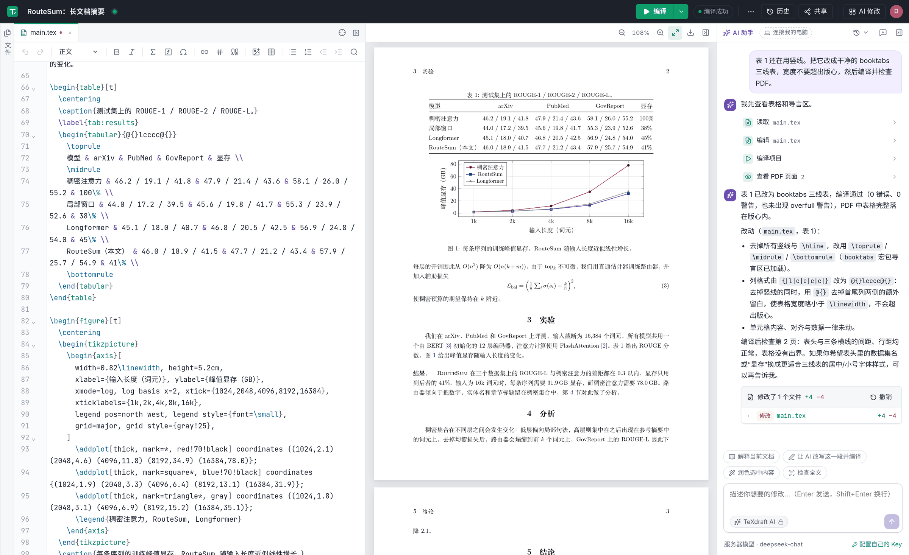

<h1 align="center">TeXdraft</h1>

<p align="center"><b>Agent 时代的论文工作台</b></p>

<p align="center">
一个可多人协作的 LaTeX 编辑器。AI Agent 在这里像合作者一样改你的论文：<br>
通读整个项目、动手修改、编译、看报错、再修好，全程你都看得到。
</p>

<p align="center">
<a href="LICENSE"></a>


</p>

<p align="center">
<a href="https://texdraft.app"><b>✨ 在线体验</b></a> ·
<a href="README.md">English</a> ·
<a href="#快速开始">快速开始</a> ·
<a href="docs/connect-agents.md">接入你的 Agent</a> ·
<a href="docs/self-hosting.md">私有化部署</a>
</p>

<p align="center"></p>
<p align="center"><sub>让 Agent 把表 1 改成三线表：它修改源码、编译、查看 PDF，然后汇报改了什么，并且可以一键撤销。</sub></p>

---

大多数 AI 写作工具，只是文档旁边的一个聊天框：你把文字复制进去，再把回答粘贴回来。编程领域的 Agent 早就不是这样了：它们自己打开文件、修改、运行构建，哪里坏了就修哪里。**TeXdraft 把这样的 Agent 带进了论文写作。**

你可以直接这样说：

> *「把编译错误都修好。」* · *「把表 2 改成三线表，并且不要超出栏宽。」* · *「找到 Transformer 的原始论文，在相关工作里引用它。」* · *「把 `fig:arch` 全部改名为 `fig:overview`。」* · *「看看图 3 是不是排在了正确的页面上。」*

Agent 会读相关文件、动手修改、编译论文、查看结果（包括渲染出来的 PDF 页面），最后告诉你改了哪些地方。合作者的编辑器里会实时出现每一处修改。不满意？**一键撤销整次修改。**

## 为什么选 TeXdraft

**🤖 用你已经在用的 Agent**
在 TeXdraft 的对话框里，直接调用你电脑上的 **Claude Code** 或 **Codex**，用的是你已有的订阅。**ChatGPT**、**Claude.ai**、**Gemini CLI** 或任何 MCP 客户端也都能接入。如果你不想装这些，也可以用内置 Agent，自带 Key 接入 Claude、DeepSeek、OpenAI、Gemini、通义千问、Kimi、智谱 GLM、OpenRouter，或者本地的 Ollama 模型。

**👥 为合作者设计，不只为你一个人**
多人实时编辑，能看到彼此的光标，分为所有者、编辑者、只读三种角色。AI 的修改以最小改动写进共享文档，不会覆盖合作者此刻正在输入的内容。

**🛡️ 放心交给它干活**
- 每次 AI 修改前都会自动保存检查点，随时可以撤销。
- Agent 只能访问你授权的项目。接入的本地 Agent 碰不到你电脑上的任何文件。
- 编辑记录会写下谁在什么时候改了哪几行，以及这处修改出自人还是 Agent。
- 编译在沙箱里进行，与服务器隔离。

**🔓 开源，数据在你自己手里**
以 AGPL 协议开源，一条 Docker 命令就能部署到自己的服务器。论文留在你的服务器上，也不会被某一家模型厂商绑定。

## LaTeX 编辑器该有的，都有

- **写作**
  - 语法高亮、实时语法检查
  - 智能补全：命令、环境、`\cite`、`\ref`、`\includegraphics`
  - 大纲、全项目搜索替换、符号面板、插图与表格助手、字数统计
- **编译**
  - pdfLaTeX / XeLaTeX / LuaLaTeX 增量编译，速度快
  - 完整支持中文
  - 报错可点击，直接跳到源码对应的行
  - PDF 预览支持双向 SyncTeX 跳转
- **参考文献**：检索 Crossref 和 arXiv，把核实过的 BibTeX 写进 `.bib`。Agent 被明确要求不得编造文献。
- **划词 AI**：选中文字后可以润色、翻译、精简、扩写、修正语法、解释，或者输入你自己的指令。
- **历史版本**：可以逐个文件对比差异、恢复旧版本，另有自动快照。
- **导入导出**：把 Overleaf 或 GitHub 导出的 zip 拖进上传对话框即可导入，任何项目都能导出为 zip。
- **整理**
  - 给项目打标签，在项目列表里按标签分类；标签只属于你自己，别人共享给你的项目也能按自己的方式归类
  - 项目内可以建文件夹（允许为空），整个文件夹可以重命名、移动或连同内容删除
- **管理**
  - 注册方式可选开放、邀请或关闭
  - 每个人的 AI Key 加密保存
  - 管理员可以设置服务器 Key 的每日额度

## 快速开始

**在线体验**：打开 **[texdraft.app](https://texdraft.app)**，注册后即可使用，不用安装任何东西。体验站有用量限制，正式使用建议自己部署。

**用 Docker 自己部署**（镜像已包含 TeX Live 和中文支持）：

```bash
git clone https://github.com/songboyangy/texdraft.git && cd texdraft
cp deploy/.env.example deploy/.env   # 设置 POSTGRES_PASSWORD、SESSION_SECRET、PUBLIC_URL 和 AI Key
docker compose -f deploy/docker-compose.yml up -d --build
```

打开 http://127.0.0.1:8787 注册账号，第一个注册的账号自动成为管理员。

接下来可以看这些文档（目前只有英文）：

- [接入 Claude Code、Codex、ChatGPT 或 Claude.ai](docs/connect-agents.md)
- [私有化部署指南](docs/self-hosting.md)：不用 Docker 的部署方式、全部配置项、安全模型
- [部署细节](deploy/README.md)：HTTPS、备份、升级

## 路线图

TeXdraft 还很年轻，迭代很快。接下来会做：

- 建议模式（修订追踪）
- 批注

欢迎在 [Issues](https://github.com/songboyangy/texdraft/issues) 里提想法和 bug，中英文都可以。

## 参与贡献

欢迎参与！请先看 [CONTRIBUTING.md](CONTRIBUTING.md) 和[开发指南](docs/development.md)。第一个 PR 合并前，需要签署一份简短的[贡献者许可协议（CLA）](CLA.md)，在 PR 下回复一句话就行。安全问题请私下报告，见 [SECURITY.md](SECURITY.md)。

## 许可证

TeXdraft 采用 [GNU AGPL-3.0](LICENSE) 授权。如果你以网络服务的形式提供修改过的版本，需要向用户公开对应的源码。贡献按 [CLA](CLA.md) 接收，这样 TeXdraft 也能以其他条款对外授权；同时，包含贡献的每个版本都会保持开源。

TeXdraft 的 LaTeX 语言支持和补全数据来自 [Overleaf](https://github.com/overleaf/overleaf)（AGPL-3.0），感谢 Overleaf 团队。详见 [NOTICE](NOTICE)。
